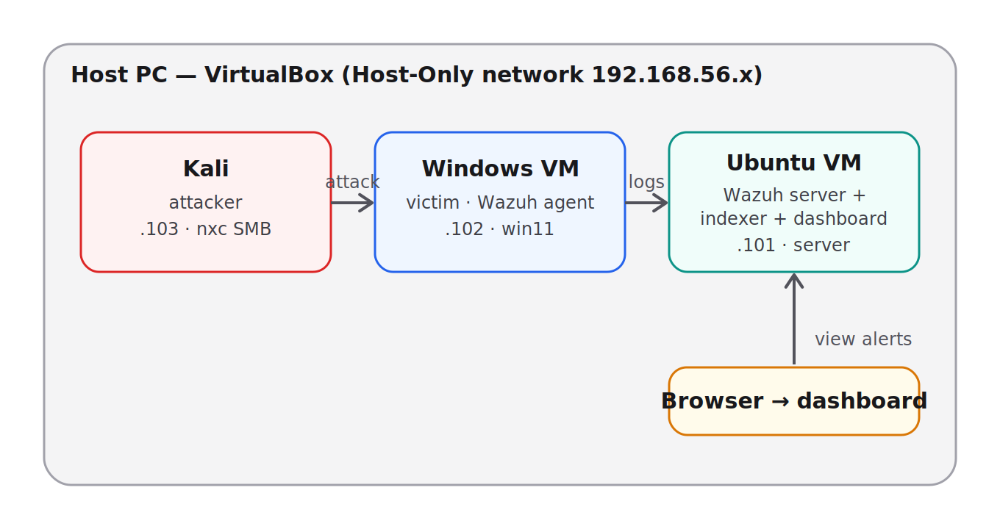

# Wazuh Home Lab — SIEM Detection & Investigation

A self-built home lab where I deployed [Wazuh](https://wazuh.com/) (open-source SIEM/XDR), generated real attacks against a monitored Windows endpoint, wrote a custom detection rule, and investigated the resulting alerts end-to-end.

The goal: hands-on experience operating a SIEM — ingesting logs, writing detections, and investigating alerts — not just installing a tool.

## Architecture

Three VMs on a VirtualBox Host-Only network (`192.168.56.x`):

- **Kali** (`.103`) — attacker
- **Windows 11** (`.102`) — victim endpoint, running the Wazuh agent
- **Ubuntu Server** (`.101`) — Wazuh server + indexer + dashboard (all-in-one)

The agent forwards Windows event logs to the Wazuh server, where rules run and alerts are generated. The dashboard is viewed from the host browser.

## What I did

**Brute-force detection (SMB)** — Ran an SMB credential brute-force from Kali. Wrote a custom Wazuh rule (ID 100100) that fires only on the *rate* of failures (8 in 30s), distinguishing an automated attack from a user mistyping a password. Investigated the alert and confirmed the outcome.
→ [Full write-up](Wazuh_Brute_Force_SMB/README.md)

**Malware detection (EICAR)** — Dropped the standard EICAR test file on the endpoint. Windows Defender caught it, but the detection didn't reach Wazuh until I configured the agent to monitor the Defender log channel. Investigated the resulting alert (rule 62123).
→ [Full write-up](Wazuh_Malware_Detection/README.md)

**Port scan (nmap) — detection gap** — Ran an nmap SYN scan. It produced *no* alert, because Windows doesn't log port scans by default. Documented as a lesson: detection depends on log availability.
→ [Full write-up](Wazuh_nmap_scan/README.md)

## Key takeaways

- **Detection depends on logging.** Two of my three attacks exposed this: the port scan wasn't logged at all, and the malware detection only worked after adding the right log source.
- **Rate is what separates attack from noise.** A single failed login and a brute-force look identical per-event; the custom rule detects the *pattern* over time.
- **Empirical validation.** I tested my own rule's behavior rather than trusting the config — and found (and documented) a zero-indexed frequency quirk.

## Files

- `architecture.png` — lab diagram
- `local_rules.xml` — the custom Wazuh detection rule
- `Wazuh_Brute_Force_SMB/` — brute-force attack, detection & investigation
- `Wazuh_Malware_Detection/` — EICAR malware detection & investigation
- `Wazuh_nmap_scan/` — port-scan detection-gap note
