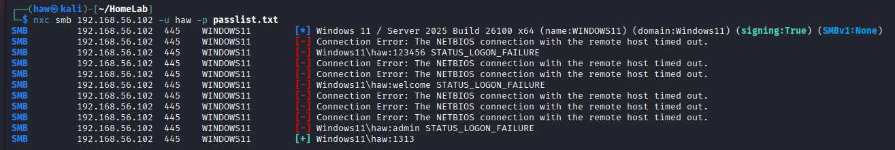
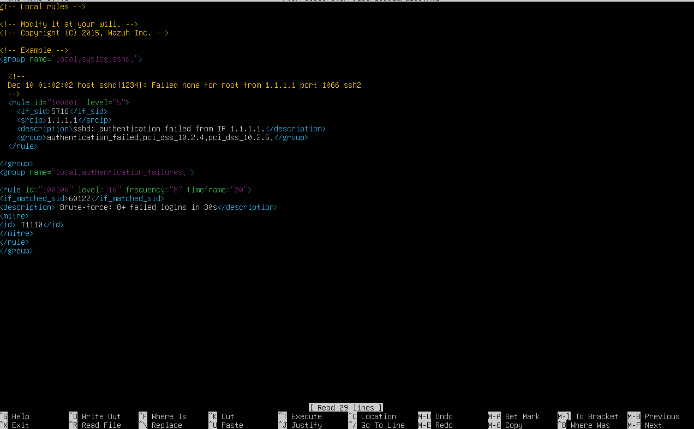
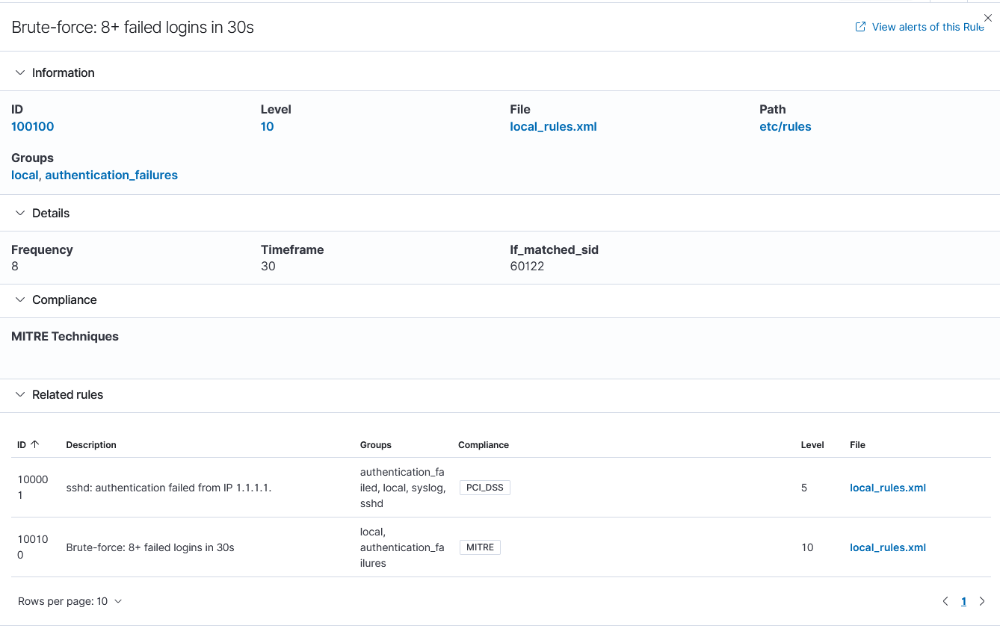
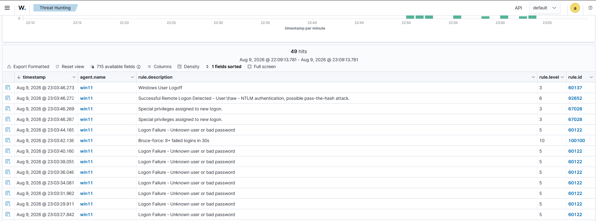
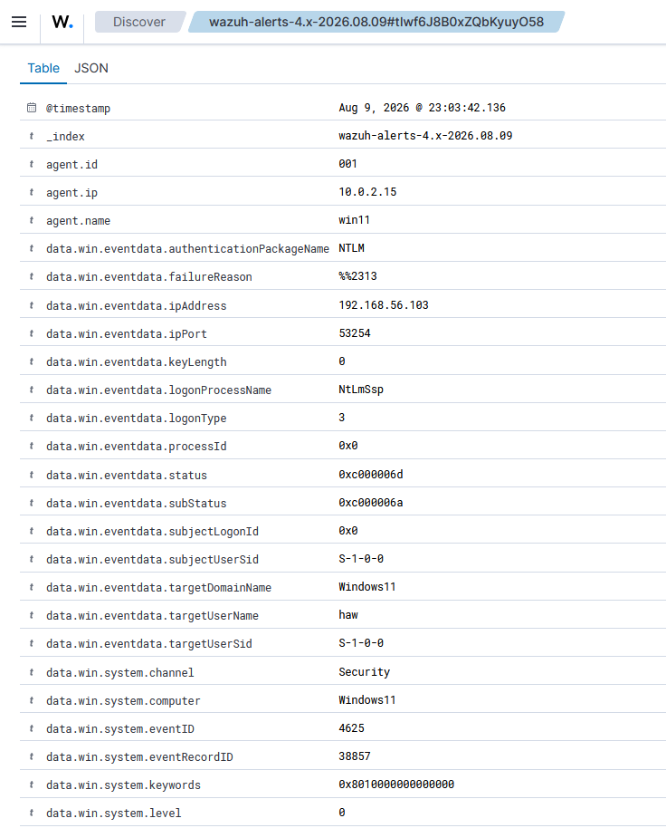

# Brute-Force Detection (SMB)

## Objective

Detect an automated credential brute-force against a Windows endpoint, and write a rule that distinguishes a real attack from a user simply mistyping their password.

## The attack

From Kali, I ran an SMB brute-force against the Windows VM using `netexec`:

```
nxc smb 192.168.56.102 -u haw -p passlist.txt
```

The password list included the account's real password, so the run produced a burst of failed logins followed by one success.



## The detection gap in the default rules

Wazuh's built-in ruleset flags each failed login individually (rule **60122** — "Logon Failure - Unknown user or bad password"). But it treats every failure as an isolated event — ten failed logins produce ten identical "one login failed" alerts. Nothing in the defaults connects them into *"this is a brute-force."*

That pattern detection is the gap I filled.

## The custom rule

I wrote a new rule (**ID 100100**) in `local_rules.xml`. It doesn't read raw logs — it *watches rule 60122* and fires when that rule triggers 8 times within 30 seconds:

```xml
<group name="local,authentication_failures,">
  <rule id="100100" level="10" frequency="8" timeframe="30">
    <if_matched_sid>60122</if_matched_sid>
    <description>Brute-force: 8+ failed logins in 30s</description>
    <mitre>
      <id>T1110</id>
    </mitre>
  </rule>
</group>
```





**Why 8-in-30s:** this threshold is the line between a real attack and human error. A person might fail a login two or three times, slowly. An automated tool fails many times per second. "8 failures in 30 seconds" is a rate a human realistically never produces, but every brute-force tool blows past instantly. `level=10` raises the severity above the individual-failure rule so the attack stands out. `T1110` maps it to MITRE ATT&CK (Brute Force).

**Validation note:** I tested the rule and confirmed it fires after **7** observed failures at `frequency=8`, consistent with Wazuh's zero-indexed frequency counter. The threshold was validated empirically rather than assumed.

## The alert firing

The events view shows the attack: a tight cluster of 60122 failures, with rule 100100 firing mid-burst, plus Wazuh's built-in rule 92652 ("possible pass-the-hash") also catching the NTLM pattern.



---

## Investigation

**Alert:** Rule 100100 — "Brute-force: 8+ failed logins in 30s"
**Time:** Aug 9, 2026 @ 23:03:42.136
**Agent:** win11 (192.168.56.102)

**What triggered it:**
Between 23:03:27 and 23:03:44, the account `haw` received a rapid cluster of failed network logons (Windows Event ID 4625, LogonType 3 / NTLM over SMB). The volume — 8+ failures inside 30 seconds — exceeded the threshold of custom rule 100100, which fired at 23:03:42.136.

**Source:**
All failures originated from **192.168.56.103** (Kali). This concentration — one source, one target, high speed — is the signature of an automated brute-force tool, not user error.



**Outcome — did it succeed?**
At 23:03:46.272, immediately after the failures, a successful remote logon for `haw` was recorded from **192.168.56.103** — the same source as the attack.
→ **Verdict: SUCCEEDED — confirmed compromise.** The brute-force guessed the password and authenticated.

**Response (if real):**
1. Block source IP 192.168.56.103 at the firewall.
2. Force a password reset on `haw`.
3. Review all `haw` sessions after the success timestamp for lateral movement.
4. Confirmed detection is not a false positive — verified by the single-source, high-rate pattern.

## MITRE ATT&CK

**T1110 — Brute Force**
