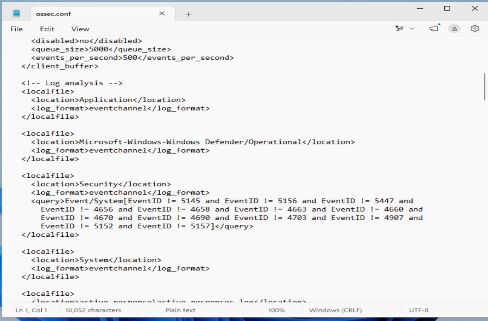
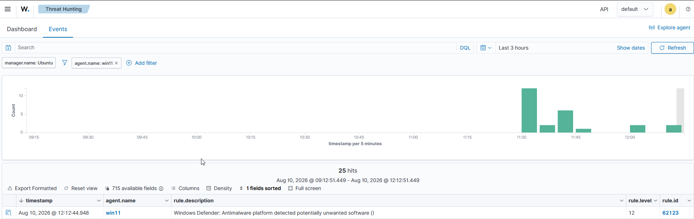
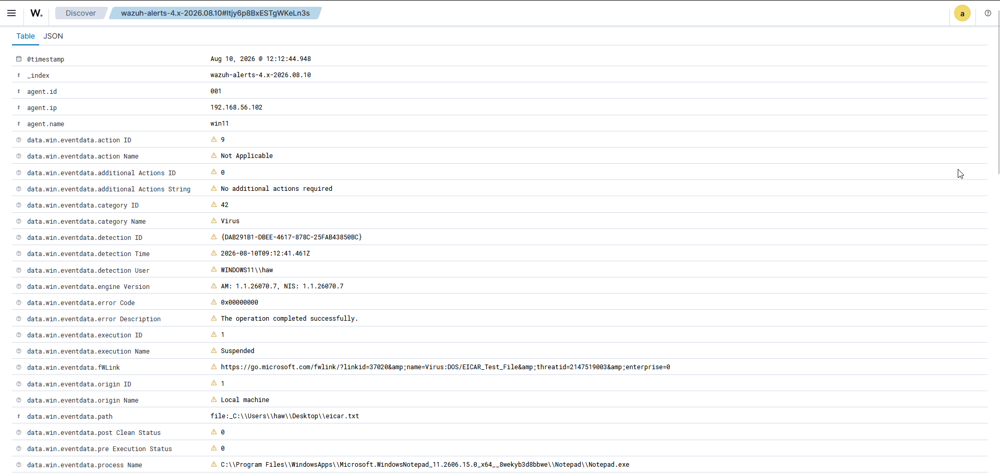

# Malware Detection (EICAR)

## Objective

Test whether malware landing on the monitored endpoint is detected and surfaced in Wazuh — using the safe EICAR test file instead of real malware.

## What EICAR is

EICAR is a harmless 68-character text string that every antivirus vendor agreed to flag *as if* it were a virus. It does nothing malicious, but it lets you test detection end-to-end without touching real malware.

## The test

On the Windows VM, I created a file containing the EICAR string on the Desktop and opened it. Windows Defender detected it on access and quarantined it immediately.


Defender reported it as `Virus:DOS/EICAR_Test_File`, severity **Severe**, status **Quarantined**.

## The detection gap — and the fix

Defender caught the file, but the detection **did not appear in Wazuh**. The reason: Defender writes its detections to its own log channel (`Microsoft-Windows-Windows Defender/Operational`), which the agent doesn't monitor by default — it only watches the Security, System, and Application channels.

I added the Defender channel to the agent's `ossec.conf`:

```xml
<localfile>
  <location>Microsoft-Windows-Windows Defender/Operational</location>
  <log_format>eventchannel</log_format>
</localfile>
```



After restarting the agent and re-triggering EICAR, the detection flowed into Wazuh.



---

## Investigation

**Alert:** Rule 62123 — "Windows Defender: Antimalware platform detected potentially unwanted software"
**Level:** 12
**Time:** Aug 10, 2026 @ 12:12:44.948
**Agent:** win11 (192.168.56.102)

**What triggered it:**
A file containing the `Virus:DOS/EICAR_Test_File` signature was written to disk at `C:\Users\haw\Desktop\eicar.txt` and detected on access by Windows Defender. The detection was logged to the `Microsoft-Windows-Windows Defender/Operational` channel and forwarded to Wazuh by the agent, matching built-in rule 62123.



**Source:**
This was a test file I created manually on the endpoint to simulate malware landing on disk (using the standard EICAR anti-malware test string). Unlike the brute-force, this is an endpoint/file-based detection, not a network attack.

**Outcome — was it contained?**
Defender's action: **quarantined**.
→ **Verdict: CONTAINED — defense succeeded, file quarantined before execution.**

**Response (if real):**
1. Confirm the file was fully removed/quarantined on the endpoint.
2. Identify how the file arrived (download, email, USB, lateral movement).
3. Scan the host for related artifacts in case it wasn't standalone.
4. Confirmed not a false positive — the signature matched a known threat, and this was a deliberate EICAR test.

## Note

This scenario contrasts with the brute-force: there, the defense *failed* (compromise). Here, the defense *succeeded* (contained). Being able to read both outcomes — breach vs. contained — is the point.
