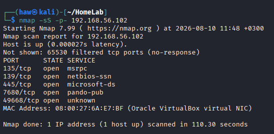

# Port Scan (nmap) — Detection Gap

## Objective

Test whether a network port scan against the Windows endpoint is detected by Wazuh.

## The scan

From Kali, I ran a full SYN scan against the Windows VM:

```
nmap -sS -p- 192.168.56.102
```



The scan completed and identified several open ports (135, 139, 445, 7680, 49668).

## Result: no alert

The scan produced **no alert in Wazuh**.

This is expected — and it's the lesson. Windows does not log port scans by default: a SYN scan just probes ports and generates no Windows Security event. The Wazuh agent forwards Windows event logs, so with no event written, there was nothing for the agent to send and nothing for Wazuh to detect.

## Takeaway

**Detection depends on log availability. No log source means no detection, regardless of rule quality.**

A good rule can't fire on data that was never collected. To actually detect scans, I would need to:

1. Enable Windows Firewall dropped-packet logging, and
2. Configure the agent to monitor that firewall log (`pfirewall.log`),

or place a network-based sensor (e.g. Suricata) in the path. This is a deliberate next step rather than a failure — it demonstrates understanding of *where* detection comes from.
